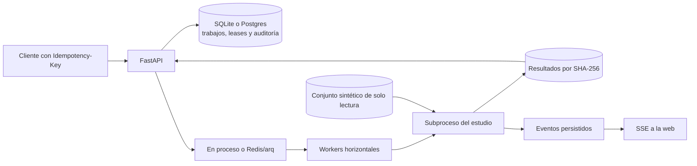

# Backend · 30/10/2026

Trabajo en `feat/plataforma`, a partir del frontend integrado de `feat/web-3d`.
Se respeta [SESION_LECTURA.md](agentes/SESION_LECTURA.md): no se modifica el arnés,
las estrategias, la calibración, OCR, entrenamiento ni sus pruebas. Sin GPU, datos privados,
push, PR ni cambios en `main`.

## Estudio como trabajo · H.1 y H.3

`POST /estudio` acepta los parámetros en español del arnés. Por defecto ejecuta únicamente
`b_reglas` en `s-dev`; otras variantes deben solicitarse explícitamente. Las rutas no forman
parte de la petición: `TRAZIA_STUDY_DATA` apunta a conjuntos administrados localmente y sus
manifiestos deben indicar `synthetic: true`.

```json
{
  "conjuntos": ["s-dev"],
  "variantes": ["b_reglas"],
  "casos": 1,
  "degradaciones": ["vectorial"],
  "remuestreos": 10,
  "semilla": 2026,
  "timeout_seconds": 300
}
```

La cabecera `Idempotency-Key` es obligatoria. La respuesta 202 lleva `job_id`.
`GET /jobs/{id}` y `/jobs/{id}/events` ofrecen estado y eventos; el endpoint de cancelación
existente sirve también para estudios. Un lease atómico evita duplicar una ejecución.
Cada estudio usa un subproceso, que se termina antes de limpiar sus temporales al cancelar
o agotar el tiempo. Un fallo no publica resultados parciales como estudios completados.
Los trabajos pendientes se recuperan al arrancar, con la misma cola en proceso o Redis/arq.

`GET /estudio?job_id=…` devuelve el informe de ese trabajo o 202 con su estado pendiente/fallido.
Sin parámetro se sirve el último estudio terminado; si no lo hay, se conserva el informe
publicado por Lectura o el estado vacío explícito. El blob JSON se guarda por SHA-256.
No se escribe en `generated/estudio/` del otro agente. Una ausencia o corrupción del blob
terminado devuelve 409, sin sustituirlo por un informe diferente.

La migración Alembic 0003 añade tipo, resultado y duración a los trabajos existentes, con
`pipeline` como valor predeterminado para los anteriores. La duración de pared del trabajo
se mide en `elapsed_seconds`. `run` queda null en estudios: no se inventa una contabilidad
agregada a partir de las métricas por variante.

El adaptador usa la firma vigente `bench.estudio.run_study`. Cuando Lectura publique la firma
exacta de `ejecutar(config, on_event)`, se podrá sustituir sin cambiar los endpoints ni la cola.
Actualmente el progreso recoge los mensajes del arnés; no se inventa un porcentaje por página.
Docker incluye `bench/` y `synthetic/` en una lista explícita de archivos permitidos; el conjunto
se monta aparte, en modo lectura. No se añaden dependencias.



## Modo offline · 4.2

Con `TRAZIA_OFFLINE=1`, la importación del paquete y los puntos de entrada de API, CLI y
worker activan el modo offline de la caché de visión existente. Se prueba una respuesta
cacheada y un fallo de caché sin ejecutar inferencia ni red. Compose propaga el mismo modo
a API y workers. Los pesos y cachés necesarios deben prepararse antes de la demostración.

La API del copiloto conserva respuestas verificadas en `TRAZIA_DATA/cache/copilot/`.
La clave incluye revisión completa, versión, pregunta, campo, revisión anterior, modelo,
host y código de reglas/herramientas/validación. Un cambio invalida la entrada.
En un acierto se comprueban otra vez los hashes de los originales citados; no se consulta
Ollama. La respuesta indica `cached: true`, con el tiempo de lectura actual y cero inferencia
nueva. Esos ceros no incluyen energía ni el coste histórico de producir la caché.
Sin respuesta, o con un original alterado, devuelve 503 recuperable. Las abstenciones no se
guardan. La API sigue rechazando respuestas si la revisión cambia durante una consulta.

El modo offline no crea pesos ausentes ni garantiza que un detector futuro de Lectura pueda
descargarse sin red. La demo web sin `NEXT_PUBLIC_API_URL` conserva además sus datos sintéticos.

## Correcciones para aprendizaje activo · avance de 3.8

`GET /learning/corrections?after=0&limit=100` exporta ejemplos sintéticos desde la auditoría.
Solo se incluyen cambios reales de valor/unidad que siguen vigentes como `corrected`, dentro
de una revisión aprobada cuya huella es válida y con original disponible e íntegro.
Cada ejemplo conserva predicción previa, corrección, fuente, documento, aprobación y actor.
Su ID estable permite deduplicar páginas; el cursor recorre la auditoría, incluidos registros
que no son ejemplos. Cambiar la revisión invalida su aprobación y retira sus ejemplos.

La respuesta declara `recalibrated: false`. No se ejecuta entrenamiento, no se mezcla el
conjunto reservado con calibración y no se inyectan ejemplos en las estrategias. La conexión
con la futura interfaz de `calibration/` sigue pendiente de Lectura: **3.8 permanece abierta**.

## Verificación

- Ruff global correcto, 131 archivos formateados.
- Batería Python completa: **240 correctas en 168,65 s**. Pruebas específicas de API/cola/copiloto: 39 correctas, sin inferencia real.
- Tipos OpenAPI regenerados; typecheck, lint (aviso previo de TanStack), 32 pruebas unitarias web y build correctos. Playwright conectado: **27 correctas y una omitida**, 1,2 min.
- Redis/arq/Postgres reales, con proyecto Compose exclusivo, sin puertos publicados: estudio
  B de un equipo sintético y dos revisiones vectoriales en **6,134 s**. Idempotencia, SSE,
  timeout, cancelación y persistencia tras reiniciar la API correctos.
- [Evidencia de esa prueba](evidencias/backend-2026-10-30/redis-study.json).

Reproducción desde la raíz, sin usar datos reales:

```bash
uv run python -c "from pathlib import Path; from synthetic.sets import generate_set; generate_set('s-dev', Path('generated/backend-check/input'), cases=1, degradations=('vectorial',))"
docker build -t trazia-platform-check:20261030 -f Dockerfile.api .
uv run python scripts/check_backend_jobs.py
# Con Docker en WSL, añadir --wsl Ubuntu al último comando y construir desde esa distribución.
uv run ruff check .
uv run ruff format --check .
uv run pytest -q
```

El script usa un proyecto Compose único y elimina solo sus contenedores y volúmenes al salir.
La API original 8010 permanece en marcha. La prueba de un equipo acredita el funcionamiento
del transporte; no es una medición completa de escala ni exactitud sobre planos de TR.
**3.7/H.7 siguen parciales**: no se repite un lote con cientos de errores ni se utiliza la GPU
reservada a Lectura. La nueva medición completa debe hacerse tras integrar la estrategia que
cubra el corpus, con coste por equipo conocido y extrapolación identificada como tal.

## Demo al cerrar

Web de producción en http://localhost:3300, conectada a la API aislada de Plataforma
en http://127.0.0.1:8011. Datos sintéticos A/B recién sembrados y sin las aprobaciones
de las pruebas; un estudio B de un equipo vectorial está disponible en Estudio/Bench.
API en modo offline para no ocupar la GPU de Lectura. El copiloto sin entrada preparada
de caché informa de esa ausencia. La API original de 8010 no se ha detenido.

Frontend cerrado en `feat/web-3d`; esta rama `feat/plataforma` lo incorpora y añade el backend.
Ambas contienen commits locales; no se fusiona a main ni se hace push o PR.
