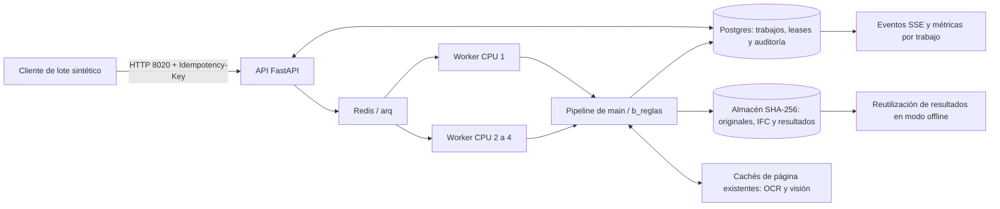

# Fase 3 · Avance de Plataforma, 27/10/2026

**Actualización 01/11:** [251 DRAFT/85 errores, 1,86× con cuatro workers y etapas por página](evidencias/fase3/01nov/resumen.md). Las secciones fechadas anteriores conservan las cifras y límites de cada sesión.

Trabajo en feat/plataforma, separado del worktree feat/lectura donde se desarrolla Fase 2.
No se editan estrategias, proveedores, generador, calibración, geometría 2D ni bench Python.
No se integra el trabajo sin terminar del otro agente. El visor 3D permanece intacto.

## 3.1 · Cambios en tres capas, verificado

Implementación previa de Plataforma, contrastada de nuevo en la batería completa:
campos con unidades/tolerancias y emparejamiento de boquillas, páginas alineadas por ECC,
geometría por GUID, marcadores/nubes candidatos y BCF 2.1. GET /diff?layers=true,
/diff/visual y /diff/bcf. Pruebas en test_plataforma_changes y test_api_base.
Los marcadores son heurísticos, no detecciones certificadas. Las capas nuevas se consumen
por API/PNG/BCF; no se añade un control nuevo a los archivos del visor protegidos.
No se declara precisión sobre datos reales ni que el extractor B cumpla el F1 final del reto.

## 3.5 · Bench conectado al estudio

Bench consulta el mismo GET /estudio y la misma query que Estudio. La fuente predeterminada
es el estudio actual, con selección de variante, rúbrica, puntuación e IC, procedencia y
restricciones. El bench v1 se conserva en una pestaña separada: no se mezclan sus métricas.
El 10 % de innovación se identifica como convención fija, sin presentarlo como medición.
La elegibilidad por cita/alucinación no se confunde con buena fidelidad geométrica.

Estudio y Bench cuentan los estilos/degradaciones realmente presentes, sin afirmar ocho
proveedores o S-reservado si el informe solo contiene S-dev. Una caída de API muestra el
error y ofrece reintentar; un informe ausente presenta estado vacío. No hay fallback de
un error de API a cifras de la demo. El modo offline conserva el lector de informes publicados.

Pruebas de navegador: mismos valores al cambiar de variante, acceso al bench v1, navegación
a Estudio, alcance parcial, error y vacío. Se revisa visualmente en claro/oscuro sobre la
API local real; capturas bajo generated/qa/fase3-bench-*.png.

## 3.6 · Copiloto local, verificado

Ya implementado con Ollama, cuatro herramientas de solo lectura y citas. La batería vuelve
a comprobar ausencia de escrituras, originales por hash, referencias desconocidas, errores,
contabilidad y revisión cambiada. Sus límites semánticos y medidas reales constan en API.md
y en el informe de Plataforma. No se declara que una cita garantice toda conclusión del modelo.

## 3.7 · Medición real de la cola, parcial

Se añaden scripts/measure_scale.py y scripts/run_scale.py, sin nuevas dependencias.
El orquestador crea proyectos Docker aleatorios con Redis/arq/Postgres y uno o cuatro
workers, concurrencia uno por worker y BLAS/OMP limitados a un hilo. Usa el mismo corpus y
almacenes nuevos por despliegue. No modifica el stack de desarrollo de localhost:3000/8000.
Al terminar elimina exclusivamente sus contenedores y volúmenes sintéticos.

El cliente sube los originales por HTTP, encola revisiones y espera estados terminales.
Mide tiempo de pared, latencia por revisión, pares equipo/condición y contabilidad disponible.
Una respuesta de error cuenta como error, nunca como modelo completado. Los tiempos incluyen
subida, HTTP, cola e instrumentación del cliente. No incluyen construir/arrancar contenedores.

### Corpus y resultados

64 equipos únicos, 168 condiciones y 336 revisiones: todos los conjuntos de Fase 1, con
sus degradaciones y ambas revisiones. Se usa B del snapshot actual, no las estrategias
que el otro agente está desarrollando. No se ajusta el extractor con estilos reservados.

| Despliegue | Tiempo lote | Subida | Terminales/s | Latencia media | P95 | done / error |
| --- | --- | --- | --- | --- | --- | --- |
| 1 worker | 221,425 s | 6,043 s | 1,517 | 18,394 s | 23,772 s | 20 / 316 |
| 4 workers | 65,445 s | 6,877 s | 5,134 | 4,813 s | 8,348 s | 20 / 316 |

La duración observada se reduce 3,38 veces en este lote. Es una medición de infraestructura
con este baseline, sin intervalo estadístico ni garantía de extrapolación a otras estrategias.
Las diferencias de caché del SO/carga de la máquina no se controlan experimentalmente.

`done` significa que el trabajo produjo un IFC que pasó validación estructural/EXPRESS.
**No significa fidelidad correcta contra la verdad**, especialmente en el corpus adversarial.

| Conjunto | done | error |
| --- | --- | --- |
| S-dev | 8 | 136 |
| S-reservado | 0 | 96 |
| S-mecánico | 0 | 72 |
| S-adversarial | 12 | 12 |

Los recuentos coinciden en ambos despliegues. Predominan errores de campos explícitos ausentes,
coherentes con las limitaciones de B antes de OCR, mecánicos y las demás estrategias de Fase 2.
No se deduce de 20 trabajos terminados que 20 modelos sean técnicamente correctos.

La contabilidad devuelve cero llamadas externas y coste null en los 336 trabajos. Se conserva
null: no se inventan euros medidos ni consumo energético/GPU. La proyección a 400 equipos ×
4 revisiones se identifica como **extrapolación** y solo estima terminaciones incluyendo
fallos. No hay estimación defendible de 1600 IFC válidos ni coste monetario completo.
Por eso 3.7 sigue abierta hasta medir una estrategia que cubra el conjunto y su coste.

[Evidencia completa por despliegue y equipo/condición](evidencias/fase3/escala.json).
El SHA del corpus y el de la imagen Docker quedan registrados. Resultados individuales de
cada trabajo en generated/scale/workers-{1,4}.json, fuera de Git, reproducibles con:

```bash
# Construir API una vez desde esta revisión del repositorio.
docker compose --profile local build api
uv run python scripts/run_scale.py --wsl Ubuntu --workers 1 4
# Sin WSL: omitir --wsl Ubuntu, con Docker y Python en PATH.
```

### Necesidades de Lectura

Repetir el lote tras integrar Fase 2. Hace falta que RunInfo informe el coste de proveedor,
con cero explícito cuando proceda, y distinga consumo desconocido. Esta petición no se resuelve
editando su código en paralelo. La cobertura real de mecánicos/escaneos y los modelos A/C/D
siguen bajo responsabilidad de Lectura. El runner admite el corpus completo sin descartarlos.

## Verificación y publicación

180 pruebas Python y Ruff global pasan. Web: typecheck/lint/15 unitarias/build correctos.
Playwright: 15 pasan con API y una exclusiva offline omitida; 11 offline y cinco exclusivas
API omitidas. Se mantienen los avisos previos de TanStack y TestClient/HTTPX.
PW_USE_BUILD permite probar un build en puertos 3100/3200 con API aislada en 8100, sin parar
el servidor dev del usuario. CI añade un job web de instalación congelada, types, lint,
unitarias y build, conservando todos los pasos y la matriz Python Windows/Linux existentes.

3.2–3.4, 3.8 y 3.11 no se marcan como terminadas. Memoria, calibración, fusión y aprendizaje
activo necesitan el trabajo de Lectura. El pitch comparativo se completará con esos resultados.
Los commits y push se realizan por petición expresa del usuario en feat/plataforma.


## Sesión 30/10 · 3.7/H.7: escala en CPU con la base de main

Se reutilizan measure_scale.py y run_scale.py. El runner permite fijar imagen, entrada,
salida, puerto 8020 y una sonda por casos/degradaciones. Rechaza los puertos reservados
a otros equipos. Cada despliegue tiene proyecto y volúmenes nuevos, Postgres, Redis/arq
y uno o cuatro workers de concurrencia uno. Se bloquea visión, no se exponen dispositivos
GPU y se limita OMP/BLAS a un hilo. TRAZIA_OFFLINE=0 permite medir el pipeline real; la
caché de resultados de trabajos no se usa para saltarse ejecuciones en este ensayo.

Base de Lectura: main a75e8ef, sin traer feat/lectura. Backend sobre feat/web-3d más las
tareas de esta sesión; model.py permanece intacto. Imagen trazia-plataforma:20261030,
con Python 3.12, IfcOpenShell 0.8.5 y el extra OCR que ya existe en el Dockerfile.
No se entrenan modelos ni se esperan funciones nuevas del otro agente.



La caché de página es distinta de la de resultados completos: OCR/visión ya identifican
una página por contenido, mientras que cambiar un documento invalida la entrada del
trabajo completo. No se ha medido una prueba multipágina incremental en este lote.

Se parte de los cuatro conjuntos sintéticos existentes: 64 equipos, 168 condiciones
y 336 revisiones con sus GA/HDM. No se filtran errores ni equipos sin cobertura. Primero
se ejecuta una sonda de D, con un equipo por conjunto y todas sus degradaciones: cuatro
equipos, diez condiciones, veinte revisiones. Resultado: 4 done y 16 error en 169,256 s;
faltan tags, dimensiones o al menos tres boquillas en varias salidas. Por eso el lote
completo usa B. La sonda no es una comparación estadística ni una medida de precisión.

Reproducción: construir la imagen en Ubuntu/WSL desde la raíz del checkout:

```sh
docker build -t trazia-plataforma:20261030 -f Dockerfile.api .
```

El corpus v2 se regenera con `uv run python -m synthetic --conjunto todos` en esta base.
Las semillas/casos por conjunto y hashes de manifiesto se registran en resumen.json.
Después, desde la misma raíz en PowerShell (con generated/synthetic_v2 ya preparado):

```powershell
uv run python scripts/run_scale.py --wsl Ubuntu --workers 1 --estrategia d_hibrido --image trazia-plataforma:20261030 --output generated/scale-probe-d --casos 1 --api-port 8020
uv run python scripts/run_scale.py --wsl Ubuntu --workers 1 4 --estrategia b_reglas --image trazia-plataforma:20261030 --output generated/scale-b-completo --api-port 8020 --eur-worker-hora 0.25
```

Con Docker nativo omitir --wsl y ejecutar todos los comandos en el mismo entorno. Los tiempos del lote incluyen subidas, HTTP, cola,
pipeline, validación y sondeo del cliente; excluyen construir/arrancar los contenedores.
No hubo pruebas propias ejecutándose durante el lote completo B. Lectura sí trabajaba
en paralelo: la CPU del portátil no estuvo dedicada exclusivamente a este ensayo.

La proyección para 400 equipos × 4 revisiones usa 1600 / throughput observado. Es una
EXTRAPOLACIÓN de terminaciones, incluidos errores; si no se completa todo el lote con
IFC estructuralmente válidos, no se calcula un tiempo para 1600 IFC válidos. El coste
de proveedores se conserva como lo declara RunInfo; null permanece desconocido. Un cero
no incluye energía ni trabajo humano. El escenario de cómputo usa una tarifa HIPOTÉTICA
de 0,25 EUR por worker-hora, aplicada al tiempo extrapolado y al número de workers;
no es precio contratado ni coste medido. Excluye API, almacenamiento y energía local.

### Resultados medidos del lote completo B

| Workers CPU | Revisiones | done | error | Tiempo total (s) | Media respuesta (s) | p95 respuesta (s) | Terminaciones/s | Coste proveedores declarado (EUR) |
| --- | --- | --- | --- | --- | --- | --- | --- | --- |
| 1 | 336 | 72 | 264 | 352.475 | 28.703 | 47.561 | 0.953 | 0.00 |
| 4 | 336 | 72 | 264 | 97.285 | 7.366 | 12.380 | 3.454 | 0.00 |

Mejora observada de tiempo con cuatro workers: **3.62×**. Misma imagen y SHA de
entrada, y el mismo estado terminal para cada una de las 336 revisiones. Cero llamadas
externas declaradas en ambos lotes. Cada despliegue parte de volúmenes nuevos; son ensayos
de pipeline en frío, sin reutilizar resultados de trabajos anteriores.

| Conjunto | done | error |
| --- | --- | --- |
| s-dev | 48 | 96 |
| s-reservado | 0 | 96 |
| s-mecanico | 0 | 72 |
| s-adversarial | 24 | 0 |

### Extrapolación a 400 equipos × 4 revisiones

| Workers | Tiempo de 1600 terminaciones (min, extrapolado) | Tiempo de 1600 IFC válidos | Coste proveedores (EUR, extrapolado) | Escenario de cómputo a 0,25 EUR/worker-h (EUR, hipotético) |
| --- | --- | --- | --- | --- |
| 1 | 27.974 | No calculable con esta cobertura | 0.00 | 0.1166 |
| 4 | 7.721 | No calculable con esta cobertura | 0.00 | 0.1287 |

El cero corresponde exclusivamente a proveedores locales declarados por RunInfo; no
es coste operativo total medido. La tabla de cómputo es una hipótesis separada. `done`
acredita generación y validación estructural/EXPRESS, no fidelidad frente a verdad de
referencia. Los 264 errores se conservan, principalmente por tags o campos obligatorios
ausentes o boquillas insuficientes. No se declara cobertura del corpus ni exactitud de TR.

El ensayo solicitado está ejecutado sobre la base disponible: no queda esperando una
función nueva de Lectura. El hito amplio 3.7/H.7 de producir todo el corpus y defender
1600 IFC válidos sigue sin acreditarse con esta cobertura. No se modifica el ROADMAP
protegido en esta sesión; esta es la propuesta de estado para su responsable.

Evidencia reproducible: [resumen y entorno](evidencias/fase3/30oct/resumen.json),
[sonda D](evidencias/fase3/30oct/sonda-d.json),
[B con un worker](evidencias/fase3/30oct/b-workers-1.json) y
[B con cuatro workers](evidencias/fase3/30oct/b-workers-4.json). Incluyen cada trabajo,
su error/contabilidad y los tiempos por equipo/condición. Equipo: Ryzen 9 8940HX,
32 hilos del host; Docker ve 24 CPU y unos 43 GiB. Imagen y hash de entrada registrados.

Verificación de cierre: Ruff check y format globales correctos, **264 pruebas Python
correctas y una omitida en 327,83 s**. La instalación requerida no incorpora el extra
OCR local; la omisión correspondiente permanece explícita. Nueve pruebas de los scripts
verifican límites de sonda, preservación de errores/coste desconocido y rechazo de
puertos reservados antes de llamar a Docker. No se modifica web ni el contrato 0.3.


## Sesión 31/10 · correcciones y nueva escala CPU

La base es main a4dd9a7, con los trabajos previos de Lectura ya integrados. Este ensayo
no incorpora su nueva fusión ni la calibración que estaba ajustando en paralelo.
Se conserva el corpus íntegro y se mide D sin proveedores de visión, con OCR CPU,
sin respuestas precalculadas de Florence, biblioteca RAG ni parámetros de calibración
montados en el contenedor. La imagen Docker se identifica por su SHA en las evidencias.

Se corrigen dos limitaciones de la entrada: el tag puede salir de un identificador
único del plano aunque el rótulo del cajetín sea desconocido; el ensamblador ya admite
las seis coordenadas trazadas de una envolvente LOD 1. El lector de bombas reconoce
alzado, planta, datum y cotas exteriores. Sus coordenadas locales de representación
son supuestos explícitos; no aparecen motores o salientes deducidos sin datos.
Los recipientes detallados mantienen todas las comprobaciones de dimensiones y boquillas.

El runner registra el LOD de cada modelo accesible y conserva los errores de consulta,
lectura y validación. `done` sigue significando IFC estructuralmente válido, no exactitud
frente al plano. Si no se lee lo necesario, el trabajo termina con su error: no se usan
la verdad sintética ni otros niveles de degradación para rellenar el equipo.

### 3.8 · circuito de recalibración CPU

`bench.recalibrar` contrasta el JSONL con SQL, la auditoría original, los originales por
hash y la aprobación vigente. Incluye confirmaciones y correcciones; deduplica clics.
Omite borradores, cambios sustituidos, predicciones sin confianza bruta, valores ya
humanos/supuestos y cambios de unidad sin normalizar. Ajuste y validación no comparten
equipos. El ajuste divide de nuevo sus equipos entre isotónica y cuantiles conformes.
Se exige muestra mínima por estrategia y un ECE de validación que no empeore. Una
estrategia sin nuevos ejemplos conserva su modelo anterior, incluidos intervalos y
abstención. La propuesta no se activa automáticamente ni cambia revisiones aprobadas.

La caché de trabajos añade la huella de calibración a su clave. Si cambia mientras
corre un trabajo no se guarda ese resultado en caché. Compose comparte el archivo
entre API y workers. El ensayo `scripts.measure_feedback` usa exclusivamente S-dev
vectorial y una revisión simulada con la verdad sintética; no representa revisiones
humanas medidas ni acredita generalización a escaneados o documentos reales.

```powershell
uv run python -m scripts.measure_feedback --data ../TrazIA-3D/generated/synthetic_v2 --output generated/recalibracion-nueva --casos 9
uv run python -m bench.recalibrar --almacen <TRAZIA_DATA> --correcciones <JSONL> --base <calibracion-base.json> --salida generated/recalibracion
```

El uso de estas correcciones como few-shot y la validación con intervenciones de uso
representativas siguen pendientes del hito completo 3.8. Detalle operativo en API.md.


### Resultados del lote D (31/10)

| Workers | Revisiones | Válidos DRAFT | Error | LOD 2 / LOD 1 | Tiempo total (s) | Respuesta media (s) | p95 respuesta (s) |
| --- | ---: | ---: | ---: | --- | ---: | ---: | ---: |
| 1 | 336 | 173 | 163 | 133 / 40 | 1823.100 | 168.374 | 280.016 |
| 4 | 336 | 173 | 163 | 133 / 40 | 1035.171 | 94.956 | 166.529 |

Aceleración observada: **1.76×**. Los 336 resultados terminales (estado, error,
LOD y familia) coinciden entre uno y cuatro workers; imagen y hash de entrada idénticos.
No hay cancelaciones ni timeouts en el lote. Los errores son falta de datos o
inconsistencias geométricas en la extracción; no se eliminan del cómputo. Los 40 modelos
LOD 1 son envolventes de bombas, sin detalle interno. El resto de válidos son LOD 2.

| Conjunto | done | error |
| --- | ---: | ---: |
| s-adversarial | 24 | 0 |
| s-dev | 75 | 69 |
| s-mecanico | 40 | 32 |
| s-reservado | 34 | 62 |

El resultado no debe atribuirse por completo a las dos correcciones de código: la
estrategia anterior era B y esta es D con OCR/geometría. Tampoco se traslada el 3,62×
anterior a esta carga. Durante el ensayo Lectura ejecutó calibración y dos estudios;
la instantánea de Docker muestra unos 2.370 % de CPU entre cuatro workers en 24 CPU
lógicas. Es una instantánea, no una media ni una atribución causal del límite de escala.
No se ejecutaron pruebas pesadas propias durante los lotes. El cliente incluye ahora
la consulta del LOD tras cada `done`, además de subida, HTTP, cola, extracción y validación;
construir/arrancar/parar Docker queda fuera del tiempo del lote.

### Proyección 400 × 4, separada de la medición

| Workers | 1600 terminaciones (min, extrapolado) | 1600 IFC válidos | Proveedores declarados (EUR) | Cómputo a 0,25 EUR/worker-h (EUR, hipotético) |
| --- | ---: | --- | ---: | ---: |
| 1 | 144.690 | No calculable | 0.00 | 0.6029 |
| 4 | 82.156 | No calculable | 0.00 | 1.3693 |

Cero llamadas externas y coste de proveedores declarado de 0 EUR en ambos lotes;
no se midieron energía, infraestructura ni trabajo humano. La tarifa por worker-hora
es solo un escenario aritmético, no un precio ni un coste real de este portátil. La
CPU compartida y los 163 errores impiden defender un tiempo de producción de 1600 IFC
correctos. **3.7/H.7 sigue parcial.**

Reproducción en Windows con WSL/Ubuntu y Docker (puerto 8022, porque Lectura ocupaba 8020):

```powershell
wsl -d Ubuntu --cd <ruta-linux-del-checkout> --exec docker build -t trazia-cierre:20261031 -f Dockerfile.api .
uv run python scripts/run_scale.py --wsl Ubuntu --workers 1 4 --estrategia d_hibrido --image trazia-cierre:20261031 --data ../TrazIA-3D/generated/synthetic_v2 --output generated/escala-nueva --api-port 8022 --eur-worker-hora 0.25
```

La imagen medida es la identificada por SHA en el informe: incluye las correcciones
de tag/envolvente. No tiene un archivo de calibración montado. Los ajustes posteriores
al alcance de la propuesta de recalibración no participan en esta medición.

Evidencias completas: [resumen](evidencias/fase3/31oct/resumen.json),
[un worker](evidencias/fase3/31oct/d-workers-1.json),
[cuatro workers](evidencias/fase3/31oct/d-workers-4.json) e
[instantánea de contención](evidencias/fase3/31oct/contencion.json).

### Ensayo del circuito de correcciones

S-dev/vectorial: **18 revisiones de nueve equipos**, con **544 etiquetas** de una
revisión explícitamente **simulada** con la verdad sintética. Se usan 376
campos para ajuste (dividido entre curva y conforme) y 168 para prueba
con equipos distintos. Tiempo total del ensayo: **6.344 s**.
ECE de B: **0.1018 → 0.0000**;
cobertura numérica de los intervalos: **100%** en este subconjunto.
La propuesta se genera, pero **no se activa**. Es una comprobación del circuito sobre
un conjunto vectorial pequeño y seleccionado, no una medida de mejora en todos los
planos. No participan S-reservado ni datos privados.

[Informe completo de recalibración](evidencias/fase3/31oct/recalibracion.json).


Por degradación (mismos resultados con uno y cuatro workers):

| Entrada | done | error |
| --- | ---: | ---: |
| Vectorial | 126 | 2 |
| Escaneado limpio | 42 | 62 |
| Escaneado pobre | 5 | 99 |

Los dos fallos vectoriales son D-712, revisiones 1/2, por menos de tres boquillas
completas. Los otros 161 errores están en escaneados. De los 163 errores, 84 son por
menos de tres boquillas completas; 63 por campos obligatorios ausentes y 16 por
incoherencias de posición de boquilla o fondo inferior. Estas cifras son estados de
generación/validación; no son precisión de extracción medida contra la verdad.

Verificación final del código: Ruff check y format correctos (153 archivos Python),
284 pruebas correctas y una omisión OCR opcional en 255,11 s. No se añadieron dependencias
ni se modificó el contrato model.py. La web pasa typecheck, lint (un aviso previo de
TanStack), 32 unitarias, builds offline/conectado y humo en ambos modos: 25 + 6 omitidas
offline y 30 + 1 omitida con API. Los puertos de prueba final fueron API 8022/web 3120,
con TRAZIA_CORS_ORIGINS explícito. La prueba de estudio ya usa una raíz temporal para
que generated/estudio de otra sesión no afecte a su estado vacío.


## Cierre de revisión y preparación del pitch (31/10)

[Auditoría E/C](AUDITORIA_REVISION.md): E.1–E.3 implementados y comprobados. E.5 tiene registro
por acción/sesión y agrupación por equipo, pero aún carece de muestra humana. El piloto se
preparó ejecutando B en CPU sobre los documentos sintéticos V-101: 22 campos A y 26 B, todos
con score bruto. No se simuló su revisión ni se aprobó ningún campo. Tiempos de pipeline
registrados: 0,2133 y 0,0900 s; no son tiempos de revisión humana.
[Evidencia de preparación](evidencias/fase3/31oct/piloto-preparacion.json).

Los pares few-shot aprobados se seleccionan/retiran por la API y se incorporan al contexto del
Copiloto, con exclusión del equipo y documentos consultados. La extracción y el ajuste de
prioridad de fuentes siguen coordinados con Lectura. La caché de trabajos incorpora SHA de
fusión y calibración. No se ha entrenado ni llamado a modelos GPU en esta sesión.

[Pitch listo para reutilizar](PITCH_ESCALA.md): diagrama en Mermaid y SVG/PNG, presupuesto
paramétrico, partidas desconocidas a null y control de cobertura. El inventario conserva los
163 errores del lote anterior. `--exigir-todos` devuelve código 2 para ese lote; `complete`
no se confunde con producir todos los DRAFT. No se ha repetido el lote completo ni se
presentan sus cifras antiguas como medición de esta revisión de código.

Se reprodujeron D-712/1 y D-712/2, vectoriales de S-reservado, con D/CPU: **dos errores en
0,9310 s de lote**, sin llamadas externas y sin correcciones inventadas. Los eventos de
geometry2d declaran dos boquillas en alzado y tres/cuatro muñones en planta, respectivamente;
el ensamblado sigue sin tres boquillas completas. Es diagnóstico, no verdad de ingeniería.
La velocidad de esta comprobación de dos fallos no se usa para extrapolar producción.
[Resultado completo](evidencias/fase3/31oct/triage-d712.json). No se ajusta el lector con
S-reservado. El artefacto de fusión aprendida no estaba en el generated/ del checkout principal;
no se presentó una ejecución sin pesos como medida de D+fusión aprendida.

Verificación del código final: Ruff check/format correctos (167 archivos), **303 pruebas Python
correctas y una omisión OCR opcional en 298,21 s**; typecheck, lint (aviso previo TanStack),
38 unitarias web y build correctos; **31 pruebas de navegador correctas y una no aplicable al
modo API en 2,1 min**. El navegador usó SwiftShader (`PW_CPU_ONLY=1`): comprueba funcionamiento
y presupuesto de triángulos, no FPS de la RTX. Las esperas del modo CPU son de 15 s y los
criterios geométricos se conservan. Se añadieron pruebas de restauración completa, concurrencia,
reloj/sesiones, retirada de ejemplos aprobados y huellas de caché.

Preview: API 8022 y web 3120, ambas locales. El almacén del piloto usa TRAZIA_OFFLINE=1 para
revisión/edición sin inferencia nueva: el Copiloto sin respuesta cacheada explica su indisponibilidad.
La [captura oscura](capturas/revision-sesion-manual-31.png) muestra la sesión preparada; la
[comprobación de interfaz](evidencias/fase3/31oct/piloto-interfaz.json) registra cero errores JS,
cero sesiones humanas y tiempo humano null. La muestra real sigue pendiente de una persona.


### Integración posterior con main e46573d

Al preparar la subida, main incorporó el modelo de fusión versionado de Lectura y cambió D
para usarlo por defecto. Los resultados 173/336 y la reproducción D-712 de esta sesión siguen
correspondiendo a D heurístico sobre la base 8713f7a; no se atribuyen al nuevo D aprendido.
La variante actual para reproducir la fusión anterior es `d_hibrido+heuristica`. El modelo
empaquetado sí participa en la huella de caché v3. Se conserva el trabajo de ambos equipos.


## Nueva medición: D aprendido y calibración v5 (31/10)

336 revisiones, 64 equipos: **174 DRAFT (134 LOD 2, 40 LOD 1) y 162 errores**, idénticos con 1/4 workers. Tiempos: **1.434,28 / 877,69 s; 1,6341× observado** en host compartido. Proveedores: cero llamadas y 0 EUR declarados; caché de trabajos: 0/336 en cada despliegue nuevo. El histórico heurístico conserva su identidad: 173 éxitos se mantienen, un fallo pasa a DRAFT y 162 siguen fallando. No se aísla causalidad ni precisión de ingeniería.

[Resultados, errores, tiempos por equipo y reproducción](evidencias/fase3/31oct-d-v5/resumen.md). La prueba real de OCR reconoce 2/1/0/2 páginas en frío/cambio/repetición/control; el render sigue recorriendo todo el PDF. No se da por resuelta la incrementalidad completa. Extrapolación a 1.600 terminaciones con cuatro workers: 69,66 min; tiempo y coste total de 1.600 IFC válidos siguen en null. 3.7/H.7 permanecen abiertas.


## 3.7 / H.7 · repetición CPU y páginas incrementales (01/11)

Mismo SHA de 336 revisiones: 251 DRAFT/85 errores (211 LOD 2, 40 LOD 1), idénticos por revisión con 1/4 workers; 1.714,18/919,26 s, **1,8647×**. 77 errores históricos pasan a DRAFT, sin transición inversa. Calidad de ingeniería sin verificar: 63 errores por campos ausentes, 22 por geometría. Caché de trabajos 0/336 y llamadas externas cero. [Inventario y medición](evidencias/fase3/01nov/resumen.md).

La reutilización medida ahora cubre render, texto, OCR y geometría por página (2/1/0/2); reconciliación e IFC son globales. Diagrama [SVG](evidencias/fase3/01nov/arquitectura-escala.svg) / [PNG](evidencias/fase3/01nov/arquitectura-escala.png). Proyección 400×4: 72,96 min con cuatro workers para terminaciones, incluidas fallidas; 0,4864 € solo de cómputo si se supone 0,10 €/worker-h. Total y presupuesto de IFC correctos null; revisión humana pospuesta. [Pitch actualizado](PITCH_ESCALA.md).

C.1/C.2 implementadas con Pint y evidencia original; C.4 interno documentado y Norte explícito opcional, referencia TR pendiente. [Normalización](NORMALIZACION.md). 3.8/E.6 conectadas a extracción/fusión con aprobación vigente y sesión humana finalizada, caché invalidada al revocar; falta muestra/evaluación real y no se activa nueva calibración con datos inventados. [Feedback](APRENDIZAJE_APROBADO.md). E.5 no se realiza por indicación de Javier.


## Diagnóstico CPU posterior · 01/11

Reproducidos los 85 errores con fuente actual y calibración v6: 85 errores, 0 recuperados;
290,244 s acumulados de pipeline, sin red/GPU/proveedores. Persisten 63 campos ausentes y 22
geometrías incoherentes. No se vuelven a medir las 251 exportaciones ni el escalado. El diagnóstico
incluye candidatos, alternativas, fuentes y GT consultada únicamente después de extraer.
[Inventario y reproducción para Lectura](evidencias/fase3/01nov-triage/resumen.md).

3.7/H.7 no se cierran: faltan cobertura y precisión suficientes y un coste defendible de 1.600 IFC
correctos. El diagrama y la extrapolación previos siguen identificados como hipótesis de cómputo,
no gasto de proyecto medido. No se debilitan los validadores para aumentar la tasa de exportación.
