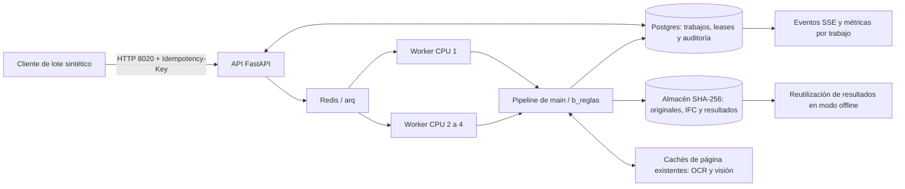

# Fase 3 · Avance de Plataforma, 27/10/2026

Trabajo en feat/plataforma, separado del worktree feat/lectura donde se desarrolla Fase 2.
No se editan estrategias, proveedores, generador, calibración, geometría 2D ni bench Python.
No se integra el trabajo sin terminar del otro agente. El visor 3D permanece intacto.

## 3.1 · Cambios en tres capas, verificado

Implementación previa de Plataforma, contrastada de nuevo en la batería completa:
campos con unidades/tolerancias y emparejamiento de boquillas, páginas alineadas por ECC,
geometría por GUID, marcadores/nubes candidatos y BCF 2.1. GET /diff?layers=true,
/diff/visual y /diff/bcf. Pruebas en test_plataforma_changes y test_api_base.
Los marcadores son heurísticos, no detecciones certificadas. Las capas nuevas se consumen
por API/PNG/BCF; no se añade un control nuevo a los archivos del visor protegidos.
No se declara precisión sobre datos reales ni que el extractor B cumpla el F1 final del reto.

## 3.5 · Bench conectado al estudio

Bench consulta el mismo GET /estudio y la misma query que Estudio. La fuente predeterminada
es el estudio actual, con selección de variante, rúbrica, puntuación e IC, procedencia y
restricciones. El bench v1 se conserva en una pestaña separada: no se mezclan sus métricas.
El 10 % de innovación se identifica como convención fija, sin presentarlo como medición.
La elegibilidad por cita/alucinación no se confunde con buena fidelidad geométrica.

Estudio y Bench cuentan los estilos/degradaciones realmente presentes, sin afirmar ocho
proveedores o S-reservado si el informe solo contiene S-dev. Una caída de API muestra el
error y ofrece reintentar; un informe ausente presenta estado vacío. No hay fallback de
un error de API a cifras de la demo. El modo offline conserva el lector de informes publicados.

Pruebas de navegador: mismos valores al cambiar de variante, acceso al bench v1, navegación
a Estudio, alcance parcial, error y vacío. Se revisa visualmente en claro/oscuro sobre la
API local real; capturas bajo generated/qa/fase3-bench-*.png.

## 3.6 · Copiloto local, verificado

Ya implementado con Ollama, cuatro herramientas de solo lectura y citas. La batería vuelve
a comprobar ausencia de escrituras, originales por hash, referencias desconocidas, errores,
contabilidad y revisión cambiada. Sus límites semánticos y medidas reales constan en API.md
y en el informe de Plataforma. No se declara que una cita garantice toda conclusión del modelo.

## 3.7 · Medición real de la cola, parcial

Se añaden scripts/measure_scale.py y scripts/run_scale.py, sin nuevas dependencias.
El orquestador crea proyectos Docker aleatorios con Redis/arq/Postgres y uno o cuatro
workers, concurrencia uno por worker y BLAS/OMP limitados a un hilo. Usa el mismo corpus y
almacenes nuevos por despliegue. No modifica el stack de desarrollo de localhost:3000/8000.
Al terminar elimina exclusivamente sus contenedores y volúmenes sintéticos.

El cliente sube los originales por HTTP, encola revisiones y espera estados terminales.
Mide tiempo de pared, latencia por revisión, pares equipo/condición y contabilidad disponible.
Una respuesta de error cuenta como error, nunca como modelo completado. Los tiempos incluyen
subida, HTTP, cola e instrumentación del cliente. No incluyen construir/arrancar contenedores.

### Corpus y resultados

64 equipos únicos, 168 condiciones y 336 revisiones: todos los conjuntos de Fase 1, con
sus degradaciones y ambas revisiones. Se usa B del snapshot actual, no las estrategias
que el otro agente está desarrollando. No se ajusta el extractor con estilos reservados.

| Despliegue | Tiempo lote | Subida | Terminales/s | Latencia media | P95 | done / error |
| --- | --- | --- | --- | --- | --- | --- |
| 1 worker | 221,425 s | 6,043 s | 1,517 | 18,394 s | 23,772 s | 20 / 316 |
| 4 workers | 65,445 s | 6,877 s | 5,134 | 4,813 s | 8,348 s | 20 / 316 |

La duración observada se reduce 3,38 veces en este lote. Es una medición de infraestructura
con este baseline, sin intervalo estadístico ni garantía de extrapolación a otras estrategias.
Las diferencias de caché del SO/carga de la máquina no se controlan experimentalmente.

`done` significa que el trabajo produjo un IFC que pasó validación estructural/EXPRESS.
**No significa fidelidad correcta contra la verdad**, especialmente en el corpus adversarial.

| Conjunto | done | error |
| --- | --- | --- |
| S-dev | 8 | 136 |
| S-reservado | 0 | 96 |
| S-mecánico | 0 | 72 |
| S-adversarial | 12 | 12 |

Los recuentos coinciden en ambos despliegues. Predominan errores de campos explícitos ausentes,
coherentes con las limitaciones de B antes de OCR, mecánicos y las demás estrategias de Fase 2.
No se deduce de 20 trabajos terminados que 20 modelos sean técnicamente correctos.

La contabilidad devuelve cero llamadas externas y coste null en los 336 trabajos. Se conserva
null: no se inventan euros medidos ni consumo energético/GPU. La proyección a 400 equipos ×
4 revisiones se identifica como **extrapolación** y solo estima terminaciones incluyendo
fallos. No hay estimación defendible de 1600 IFC válidos ni coste monetario completo.
Por eso 3.7 sigue abierta hasta medir una estrategia que cubra el conjunto y su coste.

[Evidencia completa por despliegue y equipo/condición](evidencias/fase3/escala.json).
El SHA del corpus y el de la imagen Docker quedan registrados. Resultados individuales de
cada trabajo en generated/scale/workers-{1,4}.json, fuera de Git, reproducibles con:

```bash
# Construir API una vez desde esta revisión del repositorio.
docker compose --profile local build api
uv run python scripts/run_scale.py --wsl Ubuntu --workers 1 4
# Sin WSL: omitir --wsl Ubuntu, con Docker y Python en PATH.
```

### Necesidades de Lectura

Repetir el lote tras integrar Fase 2. Hace falta que RunInfo informe el coste de proveedor,
con cero explícito cuando proceda, y distinga consumo desconocido. Esta petición no se resuelve
editando su código en paralelo. La cobertura real de mecánicos/escaneos y los modelos A/C/D
siguen bajo responsabilidad de Lectura. El runner admite el corpus completo sin descartarlos.

## Verificación y publicación

180 pruebas Python y Ruff global pasan. Web: typecheck/lint/15 unitarias/build correctos.
Playwright: 15 pasan con API y una exclusiva offline omitida; 11 offline y cinco exclusivas
API omitidas. Se mantienen los avisos previos de TanStack y TestClient/HTTPX.
PW_USE_BUILD permite probar un build en puertos 3100/3200 con API aislada en 8100, sin parar
el servidor dev del usuario. CI añade un job web de instalación congelada, types, lint,
unitarias y build, conservando todos los pasos y la matriz Python Windows/Linux existentes.

3.2–3.4, 3.8 y 3.11 no se marcan como terminadas. Memoria, calibración, fusión y aprendizaje
activo necesitan el trabajo de Lectura. El pitch comparativo se completará con esos resultados.
Los commits y push se realizan por petición expresa del usuario en feat/plataforma.


## Sesión 30/10 · 3.7/H.7: escala en CPU con la base de main

Se reutilizan measure_scale.py y run_scale.py. El runner permite fijar imagen, entrada,
salida, puerto 8020 y una sonda por casos/degradaciones. Rechaza los puertos reservados
a otros equipos. Cada despliegue tiene proyecto y volúmenes nuevos, Postgres, Redis/arq
y uno o cuatro workers de concurrencia uno. Se bloquea visión, no se exponen dispositivos
GPU y se limita OMP/BLAS a un hilo. TRAZIA_OFFLINE=0 permite medir el pipeline real; la
caché de resultados de trabajos no se usa para saltarse ejecuciones en este ensayo.

Base de Lectura: main a75e8ef, sin traer feat/lectura. Backend sobre feat/web-3d más las
tareas de esta sesión; model.py permanece intacto. Imagen trazia-plataforma:20261030,
con Python 3.12, IfcOpenShell 0.8.5 y el extra OCR que ya existe en el Dockerfile.
No se entrenan modelos ni se esperan funciones nuevas del otro agente.



La caché de página es distinta de la de resultados completos: OCR/visión ya identifican
una página por contenido, mientras que cambiar un documento invalida la entrada del
trabajo completo. No se ha medido una prueba multipágina incremental en este lote.

Se parte de los cuatro conjuntos sintéticos existentes: 64 equipos, 168 condiciones
y 336 revisiones con sus GA/HDM. No se filtran errores ni equipos sin cobertura. Primero
se ejecuta una sonda de D, con un equipo por conjunto y todas sus degradaciones: cuatro
equipos, diez condiciones, veinte revisiones. Resultado: 4 done y 16 error en 169,256 s;
faltan tags, dimensiones o al menos tres boquillas en varias salidas. Por eso el lote
completo usa B. La sonda no es una comparación estadística ni una medida de precisión.

Reproducción: construir la imagen en Ubuntu/WSL desde la raíz del checkout:

```sh
docker build -t trazia-plataforma:20261030 -f Dockerfile.api .
```

El corpus v2 se regenera con `uv run python -m synthetic --conjunto todos` en esta base.
Las semillas/casos por conjunto y hashes de manifiesto se registran en resumen.json.
Después, desde la misma raíz en PowerShell (con generated/synthetic_v2 ya preparado):

```powershell
uv run python scripts/run_scale.py --wsl Ubuntu --workers 1 --estrategia d_hibrido --image trazia-plataforma:20261030 --output generated/scale-probe-d --casos 1 --api-port 8020
uv run python scripts/run_scale.py --wsl Ubuntu --workers 1 4 --estrategia b_reglas --image trazia-plataforma:20261030 --output generated/scale-b-completo --api-port 8020 --eur-worker-hora 0.25
```

Con Docker nativo omitir --wsl y ejecutar todos los comandos en el mismo entorno. Los tiempos del lote incluyen subidas, HTTP, cola,
pipeline, validación y sondeo del cliente; excluyen construir/arrancar los contenedores.
No hubo pruebas propias ejecutándose durante el lote completo B. Lectura sí trabajaba
en paralelo: la CPU del portátil no estuvo dedicada exclusivamente a este ensayo.

La proyección para 400 equipos × 4 revisiones usa 1600 / throughput observado. Es una
EXTRAPOLACIÓN de terminaciones, incluidos errores; si no se completa todo el lote con
IFC estructuralmente válidos, no se calcula un tiempo para 1600 IFC válidos. El coste
de proveedores se conserva como lo declara RunInfo; null permanece desconocido. Un cero
no incluye energía ni trabajo humano. El escenario de cómputo usa una tarifa HIPOTÉTICA
de 0,25 EUR por worker-hora, aplicada al tiempo extrapolado y al número de workers;
no es precio contratado ni coste medido. Excluye API, almacenamiento y energía local.

### Resultados medidos del lote completo B

| Workers CPU | Revisiones | done | error | Tiempo total (s) | Media respuesta (s) | p95 respuesta (s) | Terminaciones/s | Coste proveedores declarado (EUR) |
| --- | --- | --- | --- | --- | --- | --- | --- | --- |
| 1 | 336 | 72 | 264 | 352.475 | 28.703 | 47.561 | 0.953 | 0.00 |
| 4 | 336 | 72 | 264 | 97.285 | 7.366 | 12.380 | 3.454 | 0.00 |

Mejora observada de tiempo con cuatro workers: **3.62×**. Misma imagen y SHA de
entrada, y el mismo estado terminal para cada una de las 336 revisiones. Cero llamadas
externas declaradas en ambos lotes. Cada despliegue parte de volúmenes nuevos; son ensayos
de pipeline en frío, sin reutilizar resultados de trabajos anteriores.

| Conjunto | done | error |
| --- | --- | --- |
| s-dev | 48 | 96 |
| s-reservado | 0 | 96 |
| s-mecanico | 0 | 72 |
| s-adversarial | 24 | 0 |

### Extrapolación a 400 equipos × 4 revisiones

| Workers | Tiempo de 1600 terminaciones (min, extrapolado) | Tiempo de 1600 IFC válidos | Coste proveedores (EUR, extrapolado) | Escenario de cómputo a 0,25 EUR/worker-h (EUR, hipotético) |
| --- | --- | --- | --- | --- |
| 1 | 27.974 | No calculable con esta cobertura | 0.00 | 0.1166 |
| 4 | 7.721 | No calculable con esta cobertura | 0.00 | 0.1287 |

El cero corresponde exclusivamente a proveedores locales declarados por RunInfo; no
es coste operativo total medido. La tabla de cómputo es una hipótesis separada. `done`
acredita generación y validación estructural/EXPRESS, no fidelidad frente a verdad de
referencia. Los 264 errores se conservan, principalmente por tags o campos obligatorios
ausentes o boquillas insuficientes. No se declara cobertura del corpus ni exactitud de TR.

El ensayo solicitado está ejecutado sobre la base disponible: no queda esperando una
función nueva de Lectura. El hito amplio 3.7/H.7 de producir todo el corpus y defender
1600 IFC válidos sigue sin acreditarse con esta cobertura. No se modifica el ROADMAP
protegido en esta sesión; esta es la propuesta de estado para su responsable.

Evidencia reproducible: [resumen y entorno](evidencias/fase3/30oct/resumen.json),
[sonda D](evidencias/fase3/30oct/sonda-d.json),
[B con un worker](evidencias/fase3/30oct/b-workers-1.json) y
[B con cuatro workers](evidencias/fase3/30oct/b-workers-4.json). Incluyen cada trabajo,
su error/contabilidad y los tiempos por equipo/condición. Equipo: Ryzen 9 8940HX,
32 hilos del host; Docker ve 24 CPU y unos 43 GiB. Imagen y hash de entrada registrados.

Verificación de cierre: Ruff check y format globales correctos, **264 pruebas Python
correctas y una omitida en 327,83 s**. La instalación requerida no incorpora el extra
OCR local; la omisión correspondiente permanece explícita. Nueve pruebas de los scripts
verifican límites de sonda, preservación de errores/coste desconocido y rechazo de
puertos reservados antes de llamar a Docker. No se modifica web ni el contrato 0.3.
