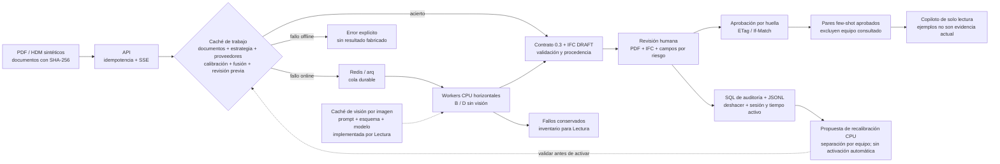

# Escala de TrazIA-3D · material para el pitch

## Afirmación defendible

En un lote sintético de 336 revisiones, D sin proveedores de visión produjo **173 IFC DRAFT**
validados por contrato/IFC y dejó **163 errores**. Cuatro workers terminaron el lote en
**1.035,17 s**, frente a **1.823,10 s** con uno: **1,76×** en un portátil con CPU compartida.
De los DRAFT, 133 son LOD 2 y 40 son envolventes LOD 1. Esto no mide precisión de ingeniería
frente al plano ni demuestra capacidad para entregar 1.600 IFC correctos.

Fuente: [medición completa y límites](FASE3.md)
y [lote de cuatro workers](evidencias/fase3/31oct/d-workers-4.json). Los tiempos son los del
lote ya medido el 31/10; este documento no los presenta como una ejecución nueva.

## Arquitectura

Diagrama para reutilizar en diapositivas: [SVG vectorial](evidencias/fase3/31oct/arquitectura-escala.svg).



La caché de trabajo reutiliza el resultado completo. La caché de visión identifica imágenes
de página/crop; no convierte toda la ingestión, el OCR CPU y la fusión en un proceso incremental
por página. Ese ahorro de extremo a extremo sigue pendiente de prueba. No se ha lanzado visión
ni entrenamiento GPU para preparar este material.

## Proyecto de 400 equipos × 4 revisiones

Extrapolar la tasa observada da **82,16 minutos para 1.600 terminaciones**, incluidas las fallidas,
con cuatro workers; con uno, 144,69 minutos. El tiempo para **1.600 IFC válidos queda sin estimar**.

El presupuesto separa componentes:

`C = (T_terminal_seg / 3600 × workers × tarifa_worker_h) + C_proveedores + (400 × minutos_humanos_por_equipo / 60 × tarifa_revisor_h) + C_infra_fija`

Los minutos humanos por equipo deben incluir sus cuatro revisiones. Se necesitan sesiones
completas y una muestra representativa antes de sustituir esa variable por una medida.

| Componente | Estado | Ejemplo aritmético |
| --- | --- | ---: |
| Proveedores externos | 0 llamadas y 0 EUR declarados en el lote CPU | 0 EUR extrapolados |
| Cómputo | Tarifa supuesta de 0,25 EUR/worker-h, no precio real | 1,3693 EUR para terminaciones |
| Revisión humana | Sin muestra manual medida | Sin estimar |
| API, almacenamiento, energía e infraestructura fija | Sin tarifa/coste medido | Sin estimar |
| Total del proyecto con IFC válidos | Cobertura y partidas incompletas | Sin estimar |

El ejemplo de 1,3693 EUR solo valora worker-horas de terminaciones bajo una tarifa elegida;
no es el coste de entregar el proyecto. El calculador deja el total en `null` si falta alguna
partida y mantiene siempre separado el coste de IFC válidos.

```powershell
uv run python scripts/scale_pitch.py --entrada docs/evidencias/fase3/31oct/d-workers-4.json --salida generated/pitch-400x4.json --pendientes generated/revisiones-pendientes.jsonl --eur-worker-hora 0.25 --exigir-todos
```

Con este lote el comando escribe las evidencias y **sale con código 2**: no pasa el control de
cobertura. [Escenario calculado](evidencias/fase3/31oct/pitch-400x4.json).

## Qué impide cerrar 3.7 / H.7

El [inventario de 163 revisiones pendientes](evidencias/fase3/31oct/revisiones-pendientes.jsonl)
conserva dataset, tag, degradación, revisión, trabajo, error y huella del conjunto. Agrupa:

| Motivo | Revisiones | Trabajo necesario |
| --- | ---: | --- |
| Menos de tres boquillas completas | 84 | Recuperar lecturas y posiciones; Lectura |
| Campos obligatorios ausentes | 63 | Recuperar evidencias PDF/HDM; Lectura |
| Incoherencia geométrica | 16 | Contrastar cotas, unidades y fusión; Lectura + revisión |

161 errores proceden de escaneados; los dos vectoriales son D-712, revisiones 1/2, en
S-reservado. No se debe ajustar un lector con S-reservado: esos casos sirven para diagnosticar
la cobertura; el ajuste debe hacerse con S-dev y reevaluarse después sin filtración.

Reproducción acotada, contra una API propia y con datos sintéticos:

```powershell
uv run python scripts/measure_scale.py --api http://127.0.0.1:8022 --data ../TrazIA-3D/generated/synthetic_v2 --estrategia d_hibrido+heuristica --sets s-reservado --degradaciones vectorial --tags D-712 --output generated/triage-d712.json --exigir-todos
```

`run_scale.py` también admite `--tags` y `--exigir-todos`; conserva informes y limpia su despliegue
aislado antes de devolver el código de rechazo. Un lote completo significa que terminaron sus
trabajos; el nuevo bloque `acceptance` indica por separado si todos produjeron un IFC DRAFT.


Integración con main e46573d: D usa ahora la fusión aprendida empaquetada; las mediciones
históricas de esta página pertenecen a D heurístico. No se transfieren sus tasas al nuevo D
sin volver a medir el lote completo. El comando de diagnóstico usa explícitamente la variante
`d_hibrido+heuristica` disponible en el código integrado.
