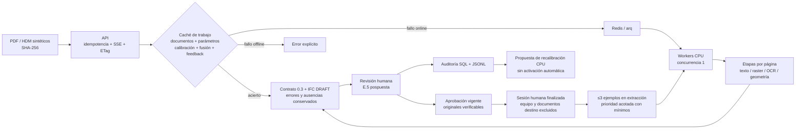

# Escala de TrazIA-3D · material para el pitch (01/11)

## Afirmación defendible

Un lote de **336 revisiones sintéticas** con D híbrido aprendido/v5 y sin proveedores de visión produjo **251 IFC DRAFT y 85 errores**. Cuatro workers terminaron en **919,26 s**, frente a **1.714,18 s** con uno: **1,86×** en el mismo portátil compartido. Las 336 coinciden en estado, LOD y error. Los DRAFT son 211 LOD 2 y 40 envolventes LOD 1. Esta cobertura no demuestra precisión de ingeniería ni entrega de 1.600 IFC correctos.

[Resultado, parámetros y reproducción](evidencias/fase3/01nov/resumen.md). Frente al registro del 31/10, 77 errores pasan a DRAFT y no hay transición inversa. Cambiaron varias piezas del código; no se atribuye esa diferencia causalmente a los pesos, al feedback ni a una sola mejora. La pasada anterior fue 174/162 y 1,63×: [histórico](evidencias/fase3/31oct-d-v5/resumen.md).

## Arquitectura para la diapositiva

[SVG vectorial](evidencias/fase3/01nov/arquitectura-escala.svg) / [PNG](evidencias/fase3/01nov/arquitectura-escala.png).



## Reutilización por página, medida

[Secuencia real en CPU y sin red](evidencias/fase3/01nov/incremental-etapas.json): A fría, B con solo página 2 cambiada, B repetida y control B frío. Render, extracción de texto, OCR y análisis geométrico vectorial/raster procesaron **2 / 1 / 0 / 2 páginas**. B caliente: 0,86 s; B fría: 3,25 s. Una secuencia, no ahorro generalizable. Se lee la estructura PDF para las huellas; reconciliación global e IFC siguen completos.

## Proyecto 400 equipos × 4 revisiones: escenario

| Componente | Resultado | Naturaleza |
| --- | ---: | --- |
| 1.600 terminaciones con cuatro workers | 72,96 min | Extrapolación, incluye fallos |
| 1.600 terminaciones con un worker | 136,05 min | Extrapolación, incluye fallos |
| Cómputo con cuatro workers | 0,4864 € | Hipótesis 0,10 €/worker-h |
| Cómputo con un worker | 0,2267 € | Misma hipótesis |
| Proveedores en las 336 revisiones | 0 € / 0 llamadas | Registrado en este lote |
| Revisión humana / infraestructura fija | Sin medir | E.5 pospuesta |
| Total / coste de 1.600 IFC correctos | Sin medir | No se deduce de este lote |

No es una tarifa contratada ni gasto cloud medido. El modelo permite cambiar las hipótesis y mantiene null si falta un componente. [Escenario JSON](evidencias/fase3/01nov/presupuesto.json):

```powershell
uv run python scripts/scale_pitch.py --entrada docs/evidencias/fase3/01nov/d-workers-4.json --salida generated/pitch-400x4.json --pendientes generated/revisiones-pendientes.jsonl --eur-worker-hora 0.10 --exigir-todos
```

Escribe las evidencias y sale con código 2 porque faltan DRAFT. Ese control no certifica precisión de ingeniería.

## Qué falta para cerrar 3.7 / H.7

[85 revisiones pendientes](evidencias/fase3/01nov/pendientes-lectura.jsonl): **63 con campos ausentes y 22 con incoherencia geométrica**. No se han rellenado cifras para forzar modelos. Cada fila conserva dataset, tag, degradación, revisión, error y huella del conjunto; puede reproducirse con --tags y --degradaciones en measure_scale.py/run_scale.py contra una API propia. S-reservado no debe usarse para ajustar el lector.

Además faltan validación de precisión de ingeniería y datos humanos para presupuestar revisión. La ampliación de extracción desde correcciones ya está conectada, con condiciones conservadoras, pero no tiene aún muestra humana ni mejora validada: [límites](APRENDIZAJE_APROBADO.md). No se cuenta una exportación adversarial como resolución correcta de su conflicto.
