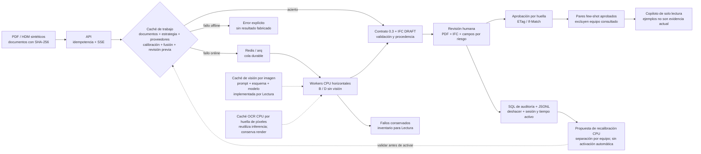

# Escala de TrazIA-3D · material para el pitch

## Afirmación defendible

En un lote sintético de 336 revisiones, D aprendido con calibración v5 sin proveedores de visión
produjo **174 IFC DRAFT** y dejó **162 errores**. Cuatro workers terminaron el lote en
**877,69 s**, frente a **1.434,28 s** con uno: **1,63×** en un portátil con CPU compartida.
De los DRAFT, 134 son LOD 2 y 40 son envolventes LOD 1. Esto no mide precisión de ingeniería
frente al plano ni demuestra capacidad para entregar 1.600 IFC correctos.

Fuente: [medición completa y límites](evidencias/fase3/31oct-d-v5/resumen.md)
y [lote de cuatro workers](evidencias/fase3/31oct-d-v5/d-workers-4.json).
La comparación con el histórico D heurístico (173/163 y 1,76×) conserva esa distinción;
no aísla el efecto causal de los pesos.

## Arquitectura

Diagrama para reutilizar en diapositivas: [SVG vectorial](evidencias/fase3/31oct/arquitectura-escala.svg).



La caché de trabajo reutiliza el resultado completo. La caché de visión identifica imágenes
de página/crop; no convierte toda la ingestión, el OCR CPU y la fusión en un proceso incremental
por página. Ese ahorro de extremo a extremo sigue pendiente de prueba. No se ha lanzado visión
ni entrenamiento GPU para preparar este material.
La prueba nueva sí verifica la caché de inferencia OCR en CPU con 2/1/0/2 llamadas reales
en frío/cambio/repetición/control; el render y el resto del pipeline no son incrementales.

## Proyecto de 400 equipos × 4 revisiones

Extrapolar la tasa observada da **69,66 minutos para 1.600 terminaciones**, incluidas las fallidas,
con cuatro workers; con uno, 113,83 minutos. El tiempo para **1.600 IFC válidos queda sin estimar**.

El presupuesto separa componentes:

`C = (T_terminal_seg / 3600 × workers × tarifa_worker_h) + C_proveedores + (400 × minutos_humanos_por_equipo / 60 × tarifa_revisor_h) + C_infra_fija`

Los minutos humanos por equipo deben incluir sus cuatro revisiones. Se necesitan sesiones
completas y una muestra representativa antes de sustituir esa variable por una medida.

| Componente | Estado | Ejemplo aritmético |
| --- | --- | ---: |
| Proveedores externos | 0 llamadas y 0 EUR declarados en el lote CPU | 0 EUR extrapolados |
| Cómputo | Tarifa supuesta de 0,25 EUR/worker-h, no precio real | 1,1610 EUR para terminaciones |
| Revisión humana | Sin muestra manual medida | Sin estimar |
| API, almacenamiento, energía e infraestructura fija | Sin tarifa/coste medido | Sin estimar |
| Total del proyecto con IFC válidos | Cobertura y partidas incompletas | Sin estimar |

El ejemplo de 1,1610 EUR solo valora worker-horas de terminaciones bajo una tarifa elegida;
no es el coste de entregar el proyecto. El calculador deja el total en `null` si falta alguna
partida y mantiene siempre separado el coste de IFC válidos.

```powershell
uv run python scripts/scale_pitch.py --entrada docs/evidencias/fase3/31oct-d-v5/d-workers-4.json --salida generated/pitch-400x4-v5.json --pendientes generated/revisiones-pendientes-v5.jsonl --eur-worker-hora 0.25 --exigir-todos
```

Con este lote el comando escribe las evidencias y **sale con código 2**: no pasa el control de
cobertura. [Escenario calculado](evidencias/fase3/31oct-d-v5/pitch-400x4.json).

## Qué impide cerrar 3.7 / H.7

El [inventario de 162 revisiones pendientes](evidencias/fase3/31oct-d-v5/revisiones-pendientes.jsonl)
conserva dataset, tag, degradación, revisión, trabajo, error y huella del conjunto. Agrupa:

| Motivo | Revisiones | Trabajo necesario |
| --- | ---: | --- |
| Menos de tres boquillas completas | 84 | Recuperar lecturas y posiciones; Lectura |
| Campos obligatorios ausentes | 63 | Recuperar evidencias PDF/HDM; Lectura |
| Incoherencia geométrica | 15 | Contrastar cotas, unidades y fusión; Lectura + revisión |

160 errores proceden de escaneados; los dos vectoriales son D-712, revisiones 1/2, en
S-reservado. No se debe ajustar un lector con S-reservado: esos casos sirven para diagnosticar
la cobertura; el ajuste debe hacerse con S-dev y reevaluarse después sin filtración.

Reproducción acotada, contra una API propia y con datos sintéticos:

```powershell
uv run python scripts/measure_scale.py --api http://127.0.0.1:8022 --data ../TrazIA-3D/generated/synthetic_v2 --estrategia d_hibrido+heuristica --sets s-reservado --degradaciones vectorial --tags D-712 --output generated/triage-d712.json --exigir-todos
```

`run_scale.py` también admite `--tags` y `--exigir-todos`; conserva informes y limpia su despliegue
aislado antes de devolver el código de rechazo. Un lote completo significa que terminaron sus
trabajos; el nuevo bloque `acceptance` indica por separado si todos produjeron un IFC DRAFT.


Nota histórica, antes de esta repetición: main e46573d incorporó la fusión aprendida.
El lote anterior de 173/163 pertenece a D heurístico; sus tasas no se transfieren al nuevo D.
El comando de diagnóstico anterior usa explícitamente la variante
`d_hibrido+heuristica` disponible en el código integrado.


## Actualización medida: D aprendido / v5, 31/10

La medición nueva produce **174 DRAFT y 162 errores** de 336 revisiones: 134 LOD 2 y 40 LOD 1. Uno/cuatro workers: **1.434,28/877,69 s (1,63×)**, mismos resultados por revisión. El lote histórico de 173/163 pertenece a D heurístico; el único cambio de estado es C-201/escaneado limpio/rev.1, sin atribución causal aislada.

[Medición nueva y límites](evidencias/fase3/31oct-d-v5/resumen.md). La extrapolación actual es **69,66 minutos para 1.600 terminaciones**, incluidas las fallidas. Con una tarifa supuesta de 0,25 EUR/worker-h, el escenario de cómputo da **1,1610 EUR**; no es precio real ni total del proyecto. Proveedores declarados: 0 EUR. Revisión humana, infraestructura y presupuesto de IFC válidos siguen sin medir.

La prueba incremental en CPU confirma caché de inferencia OCR por página (2/1/0/2 llamadas), pero el render aún procesa todas las páginas. H.7 sigue pendiente de incrementalidad de extremo a extremo y cobertura; el diagrama anterior es de arquitectura y no prueba esos resultados.
